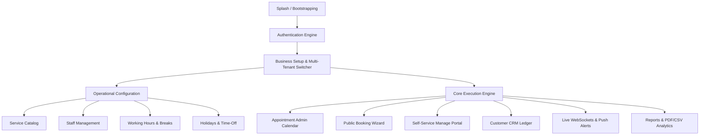
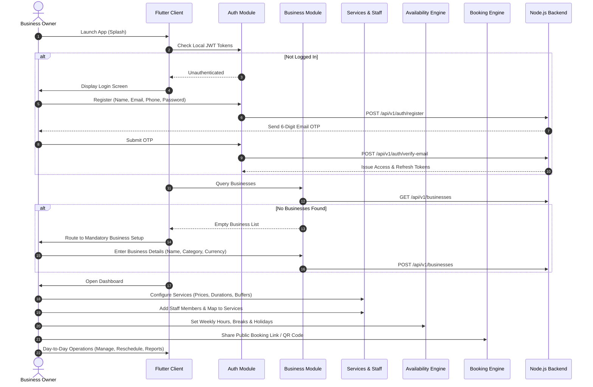
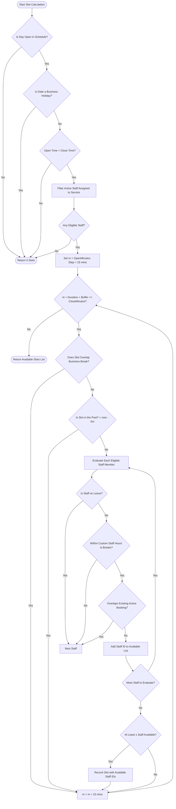
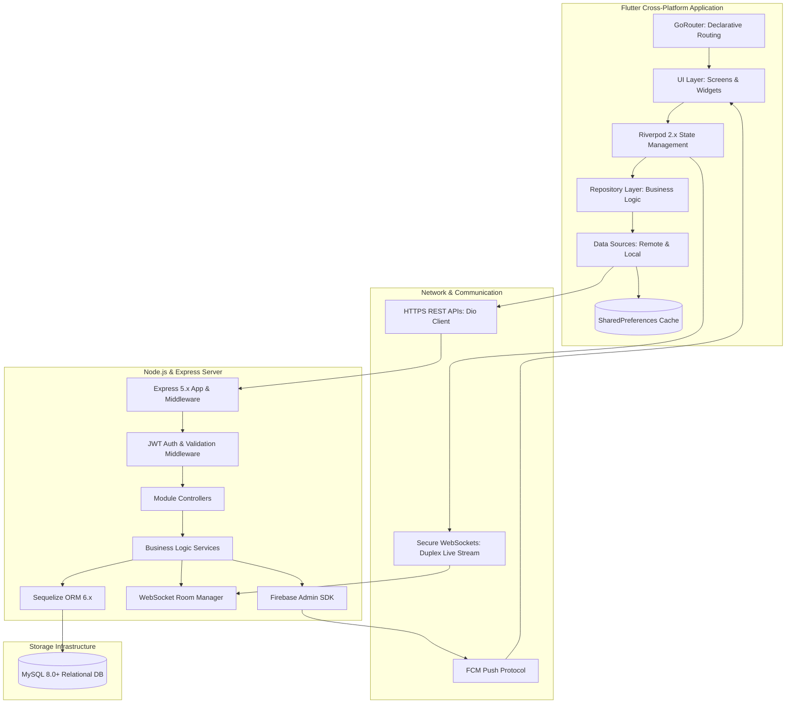
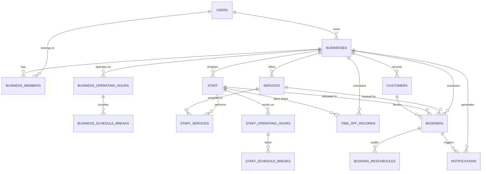

# AppointmentPro — Comprehensive Application Architecture & Technical Documentation

> **Document Version:** 1.0.0  
> **System Status:** Production Ready (Core Suite) / Hybrid REST-Offline Architecture  
> **Target Platforms:** Android, iOS, Web, macOS, Windows (Flutter 3.x / Node.js 20+ / MySQL 8.0+)  
> **Prepared By:** Senior Technical Writer, Software Architect & Business Analyst  
> **Date:** October 2026  

---

## Executive Summary

**AppointmentPro** is an enterprise-grade, multi-tenant appointment scheduling, staff orchestration, and customer management platform. Designed specifically for service-based businesses (such as medical clinics, salons, wellness spas, consulting firms, fitness studios, and auto repair centers), AppointmentPro bridges the gap between internal operational administration and seamless client-facing self-service booking.

The system is built upon a high-performance **Flutter** multi-platform client paired with a robust **Node.js (Express & Sequelize ORM)** REST and WebSocket backend backed by **MySQL 8.0+** and **Firebase Cloud Messaging (FCM)**.

This document represents the authoritative, source-code-verified architectural blueprint and operational manual of the application. Every feature, validation rule, data model, and API interaction described herein has been inspected directly from the production source code.

---

## Table of Contents

1. [Section A: Application Overview](#section-a-application-overview)
2. [Section B: Application Features (In-Depth Technical Breakdown)](#section-b-application-features)
3. [Section C: User Roles & Permissions Matrix](#section-c-user-roles--permissions-matrix)
4. [Section D: Complete Application Lifecycle & Workflows](#section-d-complete-application-lifecycle--workflows)
5. [Section E: Appointment Booking Engine & Algorithmic Breakdown](#section-e-appointment-booking-engine--algorithmic-breakdown)
6. [Section F: Business Logic, Constraints & Form Validations](#section-f-business-logic-constraints--form-validations)
7. [Section G: Technical Architecture & System Design](#section-g-technical-architecture--system-design)
8. [Section H: Data Management, Persistence & Entity Relationships](#section-h-data-management-persistence--entity-relationships)
9. [Section I: Screens Catalog & Routing Map](#section-i-screens-catalog--routing-map)
10. [Section J: Verified Implementation Status & Known Limitations](#section-j-verified-implementation-status--known-limitations)
11. [Section K: Practical Troubleshooting Manual](#section-k-practical-troubleshooting-manual)
12. [Section L: Future Architectural Roadmap](#section-l-future-architectural-roadmap)

---

## Section A: Application Overview

### 1. What is AppointmentPro?
AppointmentPro is a full-stack, cross-platform appointment scheduling system. It provides business owners and service providers with an intuitive mobile and desktop back-office to manage multiple branches, configure services, assign staff rosters, define complex weekly operating hours and break windows, track customers, analyze revenue, and receive real-time push alerts. Simultaneously, it provides customers with a zero-friction, web-accessible public booking wizard requiring no account creation.

### 2. Purpose of the Application
The primary purpose of AppointmentPro is to eliminate manual booking overhead, eradicate double-bookings, automate staff allocation, minimize customer no-shows, and deliver transparent scheduling availability directly to clients through shareable links and QR codes.

### 3. Problems It Solves
* **Double Bookings & Scheduling Conflicts:** Manual diary appointments frequently lead to overlapping time slots and overbooked staff. AppointmentPro's real-time calculation engine enforces strict interval collision checks with buffer time padding.
* **No-Shows and Late Cancellations:** Provides automated notifications, status auditing, clear cancellation reason tracking, and self-service rescheduling.
* **Complex Multi-Staff Scheduling:** Handles heterogeneous staff rotas, diverse service capabilities, custom working hours, and individual lunch/rest breaks.
* **Fragmented Client Records:** Automatically creates and updates a unified customer CRM ledger whenever an appointment is booked or modified.
* **Operational Disconnect:** Bridges back-office managers and front-line staff via live WebSocket feeds and Firebase Cloud Messaging (FCM) heads-up banners.

### 4. Target Audience
* **Small to Medium Business (SMB) Owners:** Salons, barbershops, wellness centers, dental and physiotherapy clinics, legal consultants, private tutors, and automotive service centers.
* **Service Practitioners & Staff:** Independent professionals needing visibility over their daily appointment calendar.
* **End Customers / Clients:** People seeking to schedule appointments 24/7 without making phone calls.

### 5. Supported Business Types
The system features dedicated categorizations and custom configuration for:
1. **Salon & Beauty:** Hair salons, nail bars, spas, estheticians.
2. **Health & Medical:** Dental clinics, physiotherapy, general practitioners, psychotherapy.
3. **Fitness & Wellness:** Personal trainers, yoga studios, massage therapists.
4. **Professional Consulting:** Legal advisors, tax consultants, financial planners.
5. **Automotive & Repair:** Vehicle detailing, mechanical inspections, gadget repairs.
6. **Other / Custom:** Configurable business category input for niche enterprises.

### 6. Main Value Propositions & Benefits
* **Multi-Tenant / Multi-Business Architecture:** A single registered account can create, configure, and switch between multiple distinct business profiles.
* **Intelligent Slot Calculation Engine:** Accounts for opening hours, multiple daily breaks, holiday closures, staff service qualifications, custom staff schedules, buffer minutes, and existing booking intervals.
* **Direct Public Booking Engine:** Instant customer booking wizard accessed via clean URLs (`/book/:businessSlug`) or downloadable high-resolution QR codes.
* **Self-Service Customer Management:** Clients can look up, reschedule, or cancel their own bookings using their human-readable reference code (`AP-XXXXXX`).
* **Zero-Data-Loss Architecture:** Robust local caching (via `SharedPreferences`) ensures that appointments, business records, and customer details remain accessible even during network drops.

---

## Section B: Application Features

Each feature listed below has been verified directly in the client and backend source code.



### 1. Splash & Application Bootstrapping
* **Purpose:** Safely initialize the environment, determine authentication state, verify active sessions, and navigate to the correct destination.
* **How It Works:** On launch, `SplashScreen` initializes Firebase, local notifications, and SharedPreferences. It then inspects stored JWT tokens. If valid, it fetches user profile details and business listings. If businesses exist, it sets the active business and redirects to `/dashboard`; if no businesses exist, it redirects to mandatory setup (`/business-setup?mandatory=true`). If unauthenticated, it redirects to `/login`.
* **User Actions:** Automatic launch screen; no direct input required.
* **Expected Output:** Smooth transition to Dashboard, Business Setup, or Login Screen.
* **Related Modules:** `features/splash`, `features/auth`, `features/bussiness_setup`.

---

### 2. User Authentication & Session Security
* **Purpose:** Secure multi-user access with identity verification, credential recovery, and session rotation.
* **How It Works:**
  * **Registration:** User submits full name, email, phone number, and password. The backend generates a secure bcrypt hash (`rounds=10`), stores the inactive user, generates a 6-digit verification OTP (10-minute expiry), and transmits a verification email via Nodemailer.
  * **Email Verification:** User inputs the 6-digit code. On successful verification, the user account is activated, the OTP record is purged, and access/refresh JWT tokens are issued.
  * **Login:** User inputs credentials. The backend verifies whether the email is registered (returning `404` if missing) and whether the password is correct (returning `401` if mismatched). On success, token pairs are returned and stored in secure local storage.
  * **Token Refreshing:** `ApiClient` captures `401` responses across the app, holds pending requests in a synchronized FIFO queue (`Completer<String?>`), rotates the access token via `/auth/refresh-token`, and replays failed requests seamlessly.
  * **Password Recovery:** Two-step flow via `/forgot-password` (emits 6-digit reset OTP) and `/reset-password` (verifies OTP and replaces password hash).
  * **Logout:** Informs the server, unregisters the device FCM token, disconnects the active WebSocket, purges local cache, and resets all Riverpod providers.
* **Input Fields & Validation Rules:**
  * *Full Name:* Required, 2 to 100 characters, letters and spaces only.
  * *Email:* Valid RFC 5322 regex format, normalized to lowercase.
  * *Phone:* 10 to 15 digits with international dialing code prefix.
  * *Password:* Minimum 8 characters; must contain at least 1 uppercase letter, 1 lowercase letter, 1 numeric digit, and 1 special character (`@$!%*?&#`).
  * *OTP:* Exactly 6 numeric digits.
* **Related Modules:** `features/auth`, `core/services/api_client.dart`, `Server/modules/auth`.

---

### 3. Multi-Business Profile Management
* **Purpose:** Enable entrepreneurs to operate multiple businesses or branch concepts under a single login.
* **How It Works:** Users can create new business profiles with custom names, categories, contact information, logos, currencies, and timezones. The system generates a URL-safe unique `slug` (e.g., `metro-hair-salon`). Users can toggle the active business; selecting a business cascades across the application, refreshing services, staff, bookings, availability, and customer lists.
* **Input Fields:** Business Name, Category dropdown (Salon, Health, Fitness, Consulting, Automotive, Other), Country Code, Phone, Email, Currency (INR, USD, EUR, GBP, AUD, CAD), Timezone.
* **User Actions:** Create business, edit profile, switch active business, delete business.
* **Related Modules:** `features/bussiness_setup`, `features/dashboard`.

---

### 4. Service Catalog Management
* **Purpose:** Define and maintain the list of billable services offered by the business.
* **How It Works:** Owners configure services including name, price, duration (in minutes), buffer time (in minutes), and description. Services can be activated or deactivated without losing historical booking references.
* **Input Fields & Rules:**
  * *Service Name:* Required, 2 to 255 characters.
  * *Price:* Numeric, non-negative (`>= 0.00`).
  * *Duration:* Integer, minimum 5 minutes, maximum 480 minutes (8 hours).
  * *Buffer Minutes:* Integer, 0 to 120 minutes (used for post-appointment cleanup or preparation).
  * *Active Status:* Boolean toggle.
* **Related Modules:** `features/services`, `features/bookings`.

---

### 5. Staff Management & Capability Assignment
* **Purpose:** Manage service professionals, their contact info, profile avatars, and service qualifications.
* **How It Works:** Staff members are created with contact information and assigned specific services (M:N mapping). Staff can either inherit the default business opening hours or have customized individual schedules with unique breaks.
* **Input Fields & Rules:**
  * *Staff Name:* Required, 2 to 100 characters.
  * *Email:* Optional, valid email format.
  * *Phone:* Optional, 10 to 15 digits.
  * *Assigned Services:* Multi-select checkboxes mapping to active services.
  * *Active Status:* Boolean toggle.
* **Related Modules:** `features/staff`, `features/services`, `features/availability`.

---

### 6. Operating Hours & Weekly Availability
* **Purpose:** Define business operating hours across all seven days of the week.
* **How It Works:** Days are indexed from `1` (Monday) to `7` (Sunday). Each day has an `isOpen` boolean toggle, opening time (`HH:mm`), and closing time (`HH:mm`).
* **Validation Rules:**
  * Opening time must strictly precede closing time (`openMinutes < closeMinutes`).
  * Closed days are completely bypassed during customer slot calculations.
* **Related Modules:** `features/availability`, `features/bookings`.

---

### 7. Schedule Breaks Management
* **Purpose:** Schedule planned operational closures during the working day (e.g., lunch breaks, sanitation periods).
* **How It Works:** Each day can contain multiple breaks. A break consists of a start time and end time.
* **Validation Rules:**
  * Break start must be before break end.
  * Break must fall strictly within that day's operating hours (`isWithin(parentOperatingHours)`).
  * Multiple breaks on the same day cannot overlap (`overlaps(otherBreak) == false`).
* **Related Modules:** `features/availability`, `features/bookings`.

---

### 8. Time-Off & Holidays Management
* **Purpose:** Record whole-day or multi-day business closures and individual staff leaves.
* **How It Works:** Owners can create holiday entries with a title, start date, and end date. If `staffId` is null, the closure applies to the entire business (no booking slots generated for anyone). If `staffId` is specified, only that individual staff member is omitted from candidate selection during that period.
* **Validation Rules:** Start date must be on or before end date. Cannot book appointments during holiday intervals.
* **Related Modules:** `features/availability`, `features/staff`.

---

### 9. Appointment Booking & Administration Dashboard
* **Purpose:** Provide staff with a real-time calendar and agenda list of all appointments.
* **How It Works:** Displays bookings filtered by date, status, or staff member. Provides one-tap status transitions:
  * **Confirmed -> Completed:** Marks service delivered and updates customer analytics.
  * **Confirmed -> Cancelled:** Prompts for a cancellation reason, frees up staff slots, and records cancellation timestamp.
  * **Confirmed -> No Show:** Flags client failure to attend.
  * **Reschedule:** Opens reschedule modal to re-evaluate availability and shift appointment time with audit history.
* **Related Modules:** `features/bookings`, `features/dashboard`, `features/notifications`.

---

### 10. Direct Public Customer Booking Wizard
* **Purpose:** Provide an end-to-end self-service scheduling portal accessible without login.
* **How It Works:** Customers navigate to `/book/:businessSlug` or scan the business QR code. A 6-step guided wizard executes:
  1. **Select Service:** Displays service cards with price, duration, and buffer info.
  2. **Select Staff:** Customer can pick a specific professional or choose **"Any Available"**.
  3. **Select Date & Time:** Interactive calendar computes real-time open slots in 15-minute intervals.
  4. **Customer Details:** Customer enters Name, Country Code, Phone Number, Email, and Notes.
  5. **Review Summary:** Displays full appointment summary and booking policy.
  6. **Confirmation:** Creates appointment, generates human-friendly reference (`AP-XXXXXX`), displays QR code, and offers "Add to Calendar" and "Manage Booking" links.
* **Related Modules:** `features/bookings/presentation/screens/public_booking_screen.dart`.

---

### 11. Public Booking Self-Service Portal
* **Purpose:** Allow customers to check appointment status, reschedule, or cancel on their own.
* **How It Works:** Located at `/book/:businessSlug/manage`. Customers enter their booking reference or phone number. They can view booking details, submit a cancellation with an optional reason, or reschedule to another open slot.
* **Related Modules:** `features/bookings/presentation/screens/public_booking_manage_screen.dart`.

---

### 12. Customer / Client Relationship Management (CRM)
* **Purpose:** Centralize customer contact history, loyalty metrics, and appointment records.
* **How It Works:** Every completed or created booking automatically creates or updates a record in the `customers` table (matched uniquely on `business_id` + `phone`). The CRM displays total bookings, last visit date, customer phone, email, and personal notes.
* **Related Modules:** `features/customers`, `features/bookings`.

---

### 13. Push Notifications & In-App Notification Center
* **Purpose:** Alert owners and staff instantly regarding new bookings, cancellations, and reschedules.
* **How It Works:** Uses a dual-layer notification architecture:
  * **Firebase Cloud Messaging (FCM):** Background and terminated state OS notifications.
  * **Flutter Local Notifications:** High-importance heads-up banners with custom sound and vibration while the app is active.
  * **Notification Center:** In-app inbox listing unread notifications with badge count, mark-as-read actions, and deep-linking to booking details.
* **Related Modules:** `features/notifications`, `core/services/fcm_service.dart`, `core/services/local_notification_service.dart`.

---

### 14. Real-Time Live Synchronization (WebSockets)
* **Purpose:** Keep multiple open app instances in sync without polling or manual refreshing.
* **How It Works:** `WebSocketService` establishes an encrypted duplex stream to the Node.js backend. Upon connection, the client joins its business room (`businessId`). When an appointment is booked, rescheduled, or cancelled from any device or public browser, a WebSocket event is broadcast to all clients in that business room, triggering immediate Riverpod state invalidation.
* **Related Modules:** `core/services/websocket_service.dart`, `Server/modules/websocket`.

---

### 15. Reports & Analytics Engine
* **Purpose:** Deliver business intelligence metrics and professional PDF/CSV export capabilities.
* **How It Works:** Analyzes appointment records over selectable timeframes (Today, This Week, This Month, This Year, Custom Date Range). Computes:
  * **Total Revenue:** Sum of prices for non-cancelled appointments.
  * **Total Bookings Count:** Grouped by status (Completed, Confirmed, Cancelled, No-Show).
  * **Completion & Cancellation Rates:** Percentages of total throughput.
  * **Average Booking Value (ABV):** Mean revenue per client visit.
  * **Top Performing Services & Staff:** Rank ordered by appointment volume and earnings.
  * **Exports:** Formats reports into printable PDF documents (using `pdf` and `printing` packages) and raw CSV spreadsheets.
* **Related Modules:** `features/reports`.

---

### 16. Theme & Visual Preferences
* **Purpose:** Support comfortable usage across all environments.
* **How It Works:** Riverpod-managed `themeModeProvider` persisted in SharedPreferences. Supports **Light Mode**, **Dark Mode**, and **System Default**.
* **Related Modules:** `app/theme`, `features/settings`.

---

### 17. User Profile & Account Management
* **Purpose:** Allow users to view their account info, upload profile pictures, and manage their session.
* **How It Works:** Displays account details, provides image picking via camera or gallery with automatic multipart upload to the backend, and offers a confirmed logout workflow.
* **Related Modules:** `features/profile`, `features/auth`.

---

## Section C: User Roles & Permissions Matrix

### 1. Database Schema Roles vs. Actual Client Implementation
A rigorous inspection of the database schema and Flutter client code reveals the following distinction:

| Role Name | Database Schema Definition | Backend Middleware Status | Flutter Client Implementation Status |
| :--- | :--- | :--- | :--- |
| **Owner** | Full administrative rights over businesses, members, services, and billing. | Fully supported in schema & JWT. | **Active:** All registered users currently act as Owner of their created businesses. |
| **Manager** | Operational management of staff, services, and appointments. | Supported in schema & JWT. | **Partially Implemented:** Role exists in models; screen-level restriction gating is planned for v2.0. |
| **Staff** | Limited to viewing own schedule, assigned clients, and appointments. | Supported in schema. | **Partially Implemented:** Staff records exist, but separate staff-restricted login portal is planned. |
| **Customer** | End customer allowed to book, reschedule, or cancel own appointments. | Supported in schema. | **Active via Public Booking:** Customers interact without accounts via the web booking wizard. |

> [!NOTE]
> Currently in the Flutter mobile application, any user who registers and logs in operates with full **Owner/Administrator** capabilities over their business profiles. Granular role-based UI access control (RBAC) is architecturally prepared in the data models and backend tables, but client-side route guards are unified.

### 2. Operational Permissions Breakdown

| Capability / Module | Owner (Current App) | Manager (Planned) | Staff (Planned) | Customer (Public Web) |
| :--- | :---: | :---: | :---: | :---: |
| Register & Verify Account | ✔ | ✖ (Invited) | ✖ (Invited) | ✖ (No Account) |
| Create / Edit Business Profile | ✔ | ✖ | ✖ | ✖ |
| Delete Business Profile | ✔ | ✖ | ✖ | ✖ |
| Add / Edit / Remove Services | ✔ | ✔ | ✖ | ✖ |
| Add / Edit / Remove Staff | ✔ | ✔ | ✖ | ✖ |
| Configure Working Hours & Breaks | ✔ | ✔ | ✖ (Own schedule only) | ✖ |
| View All Bookings & Calendar | ✔ | ✔ | ✖ (Own bookings only) | ✖ |
| Book Appointment Internally | ✔ | ✔ | ✔ | ✖ |
| Book Appointment Publicly | ✔ | ✔ | ✔ | ✔ |
| Reschedule / Cancel Any Booking | ✔ | ✔ | ✖ (Requires approval) | ✖ |
| Reschedule / Cancel Own Booking | ✔ | ✔ | ✔ | ✔ (Using ref code) |
| Access Financial Reports & Analytics | ✔ | ✔ (No profit margins) | ✖ | ✖ |
| Export PDF / CSV Analytics | ✔ | ✖ | ✖ | ✖ |

---

## Section D: Complete Application Lifecycle & Workflows



### Step-by-Step Walkthrough

#### 1. Installation & Initial Bootstrapping
When the user installs and opens AppointmentPro, the application boots through `main.dart`. It initializes `WidgetsFlutterBinding`, connects to `Firebase`, registers `FlutterLocalNotificationsPlugin`, initializes `FcmService`, and loads `SharedPreferences`. The `SplashScreen` assesses session validity:
* If tokens are absent, the user is navigated to `/login`.
* If tokens exist but the account has no business profiles, it navigates to `/business-setup?mandatory=true`.
* If an active business exists, it transitions smoothly into the main bottom-navigation dashboard at `/dashboard`.

#### 2. Registration & Email Verification
New users navigate to `/register`. Upon submitting the validated registration form, an account record is provisioned in the database in an unverified state (`is_email_verified = 0`). An OTP is dispatched to the user's email inbox. The app transitions to `/verify-otp`. Submitting the valid code activates the user account and persists authentication credentials.

#### 3. First-Time Business Setup
If the account has no registered businesses, the router enforces mandatory setup. The owner enters business name, type, country code, phone, and currency. The backend verifies slug uniqueness and inserts default Monday–Friday operating hours (09:00 to 18:00).

#### 4. Service Configuration
Owners add their service menu via `/services/create`. Each service requires a name, pricing, service duration in minutes, and optional post-service buffer time.

#### 5. Staff Configuration & Capability Assignment
Staff members are added via `/staff/create`. The owner assigns which services each staff member is qualified to perform (M:N mapping). Staff members can also have custom schedules if their hours differ from the master business hours.

#### 6. Working Hours & Break Configuration
Via `/availability`, the owner configures the weekly operational schedule:
* Toggle each day of the week Open or Closed.
* Define opening time and closing time.
* Add one or more daily breaks (e.g., Lunch from 13:00 to 14:00).
* Define business holidays and staff leave dates.

#### 7. Appointment Booking (Internal & Public)
* **Internal:** The business owner or manager books walk-in or telephone clients directly through the application.
* **Public:** The owner shares the generated business link (`/book/:businessSlug`) or prints the QR code. Clients access the web booking wizard, select their service, choose their preferred specialist or "Any Available", pick an open time slot, input their details, and receive an instant booking confirmation.

#### 8. Day-to-Day Administration & Analytics
* Incoming bookings trigger real-time push notifications and update the dashboard live via WebSockets.
* Staff track the daily schedule, mark appointments as completed or no-show, or process client cancellations.
* At any time, owners inspect revenue KPIs, service distributions, and export official reports as PDF or CSV.

---

## Section E: Appointment Booking Engine & Algorithmic Breakdown

The slot calculation algorithm located in `BookingAvailabilityCalculator.calculateAvailableSlots()` is the computational core of AppointmentPro. It runs client-side for instant customer interaction and is re-verified by the backend prior to database insertion.



### Detailed Step-by-Step Algorithmic Logic

1. **Day of Week Schedule Check:**
   The target date's weekday (`1 = Monday` ... `7 = Sunday`) is queried against `BusinessAvailability.weeklySchedule`. If the day is missing or `isOpen == false`, slot generation immediately halts and returns an empty list.

2. **Business-Wide Holiday Check:**
   The algorithm cross-references the date against the `timeOffList`. Any record with `isBusinessWide == true` where `startDate <= targetDate <= endDate` aborts generation and returns an empty list.

3. **Operating Bounds & Duration Evaluation:**
   Operating hours are converted to absolute minutes from midnight (`openMinutes` and `closeMinutes`). Total required slot footprint is computed as:
   $$\text{Total Footprint} = \text{serviceDuration} + \text{bufferMinutes}$$
   If `openMinutes >= closeMinutes` or `serviceDuration <= 0`, generation terminates.

4. **Candidate Staff Identification:**
   The algorithm filters all staff members who satisfy three mandatory criteria:
   * `staff.isActive == true`
   * `staff.assignedServiceIds.contains(service.id)`
   * If a specific staff member was requested by the customer, `staff.id == requestedStaffId`.

5. **Stepped Time Window Traversal:**
   The algorithm iterates through the working day using a **15-minute resolution step** (`stepMinutes = 15`):
   * Slot Start: `m`
   * Slot End: `m + serviceDuration`
   * Slot Buffer End: `m + serviceDuration + bufferMinutes`

6. **Business Break Rejection:**
   If the interval `[slotStart, slotBufferEnd]` overlaps any configured business break for that day, the slot is immediately discarded.

7. **Past Time Pruning:**
   Slots whose start time precedes the current timestamp (`DateTime.now()`, with a 5-minute grace leeway) are discarded to prevent booking appointments in the past.

8. **Individual Staff Collision & Availability Analysis:**
   For every candidate staff member, the algorithm performs three individual checks:
   * **Personal Leave:** Checks if the staff member has a record in `timeOffList` covering this date.
   * **Custom Staff Schedule:** If the staff member has customized operating hours, verifies that the slot falls within their personal open/close hours and outside their personal breaks.
   * **Booking Collision Check:** Evaluates all existing active bookings (excluding cancelled ones). A conflict exists if:
     $$\text{slotStart} < \text{booking.endAt} \quad \text{AND} \quad \text{slotBufferEnd} > \text{booking.startAt}$$
   If no conflict exists, the staff member's ID is appended to `availableStaffIds`.

9. **Slot Emission:**
   If `availableStaffIds.isNotEmpty`, a new `BookingSlot` is constructed containing the start time, end time, formatted time strings, and the array of eligible staff IDs.

10. **Intelligent "Any Available" Staff Allocation:**
    When a customer selects "Any Available", the system executes `BookingAvailabilityCalculator.selectBestStaffForSlot()`. This algorithm counts the number of existing appointments each candidate staff member already has scheduled for that specific date and assigns the appointment to the staff member with the lowest current workload, achieving automatic load balancing.

11. **Rescheduling & Cancellation Engine:**
    * **Rescheduling:** Evaluates the candidate slot using the same collision rules, but passes `ignoreBookingId` so the appointment being rescheduled does not conflict with its own original time window. Upon confirmation, a new record is appended to `booking_reschedules` recording the previous start/end, new start/end, timestamp, and optional reason.
    * **Cancellation:** Updates booking status to `cancelled`, records `cancellation_reason` and `cancelled_at`, releases staff allocation, and emits a notification event.

---

## Section F: Business Logic, Constraints & Form Validations

### 1. Form Validation Rules

| Entity / Field | Validation Rule | Error Message Prompt |
| :--- | :--- | :--- |
| **User: Full Name** | Non-empty, 2–100 chars, letters/spaces only | *"Please enter a valid full name (letters only)."* |
| **User: Email** | Regex: `^[\w-\.]+@([\w-]+\.)+[\w-]{2,4}$` | *"Please enter a valid email address."* |
| **User: Phone** | Non-empty, 10–15 numeric digits | *"Please enter a valid 10-15 digit phone number."* |
| **User: Password** | Min 8 chars, 1 uppercase, 1 lowercase, 1 digit, 1 special | *"Password must be at least 8 chars with uppercase, lowercase, number & special char."* |
| **User: OTP** | Exactly 6 numeric digits | *"Please enter the complete 6-digit verification code."* |
| **Business: Name** | Non-empty, 2–255 characters | *"Business name is required."* |
| **Business: Slug** | URL-safe alphanumeric and hyphens, unique | *"Slug must be unique and URL-friendly."* |
| **Business: Currency** | Exactly 3 uppercase letters (ISO 4217) | *"Currency code must be 3 letters (e.g., INR, USD)."* |
| **Service: Name** | Non-empty, 2–255 characters | *"Service name is required."* |
| **Service: Price** | Decimal number, `>= 0.00` | *"Price cannot be negative."* |
| **Service: Duration** | Integer between 5 and 480 minutes | *"Duration must be between 5 and 480 minutes."* |
| **Service: Buffer** | Integer between 0 and 120 minutes | *"Buffer minutes must be between 0 and 120."* |
| **Staff: Name** | Non-empty, 2–100 characters | *"Staff name is required."* |
| **Staff: Services** | At least one service selected (recommended) | *"Assign at least one service to this staff member."* |
| **Schedule: Hours** | Open Time < Close Time | *"Opening time must be earlier than closing time."* |
| **Schedule: Breaks** | Break Start < Break End & Break within Working Hours | *"Break must be within working hours."* |
| **Schedule: Overlaps** | Break 1 does not overlap Break 2 | *"Breaks cannot overlap with each other."* |

### 2. Error Handling & Architectural Resilience
* **Network Failures:** Intercepted by `ApiClient`. Throws structured `ApiException.networkError()` displaying user-friendly offline notices.
* **Session Expiry (401):** Interceptors catch expired JWTs, pause concurrent HTTP requests in a queue, call `/auth/refresh-token`, update tokens in local storage, and transparently replay the pending requests.
* **Database Unique Constraints:** Caught by backend error middleware. Returns friendly messages (e.g., *"An account with this email is already registered."* or *"A customer with this phone number already exists in your business."*).
* **Booking Conflict Preemption:** If two customers attempt to book the identical slot simultaneously, the database transaction enforces a final collision re-check before committing the booking row, rejecting the second request with a `409 Conflict` notification.

---

## Section G: Technical Architecture & System Design



### 1. Flutter Client Architecture
The Flutter frontend follows a **Feature-Driven Architecture** combined with **Clean Architecture** principles:
* **Presentation Layer:** Declarative Flutter widgets utilizing Riverpod's `ConsumerWidget` and `ConsumerStatefulWidget`. Screens communicate exclusively with providers, maintaining zero direct database or API knowledge.
* **Domain / State Layer:** Powered by **Riverpod 2.x**. State is managed via `AsyncNotifier`, `Notifier`, `StateProvider`, and `StreamProvider`. State transitions are immutable and guarded using `AsyncValue.guard()`.
* **Repository Layer:** Acts as the single source of truth for data operations. Repositories coordinate remote API calls and local offline caches, providing graceful fallbacks during connectivity outages.
* **Data Source Layer:** Separated into `RemoteDataSource` (making typed HTTP calls via `ApiClient`) and `LocalDataSource` (serializing entities into SharedPreferences JSON storage).
* **Core Services:** Reusable singleton services for API networking (`Dio`), device push notifications (`FcmService`), OS system tray alerts (`LocalNotificationService`), and real-time sockets (`WebSocketService`).

### 2. Backend Server Architecture
* **Runtime & Framework:** Node.js 20+ running Express 5.x with ES modules and CommonJS compatibility.
* **Database & ORM:** MySQL 8.0+ managed via Sequelize ORM 6.x. Schema features foreign key constraints, cascading updates/deletions, indexed lookup paths, and utf8mb4 character encoding.
* **Authentication:** Stateless JSON Web Tokens (JWT). Access tokens (15-minute lifespan) and Refresh tokens (30-day lifespan) signed with HMAC-SHA256. Passwords hashed using bcrypt.
* **Push Notifications:** Firebase Admin SDK integrates with FCM to dispatch targeted push alerts to registered device tokens upon booking events.
* **Real-Time Layer:** Native Node.js `ws` WebSocket server. Manages client heartbeats (ping/pong every 30s) and partitions clients into isolated business rooms for targeted event broadcasts.

### 3. Complete Source Code Directory Tree

```
appointment_pro/
├── lib/
│   ├── app/
│   │   ├── router/
│   │   │   └── app_router.dart              # GoRouter definitions, transitions & route guards
│   │   ├── theme/
│   │   │   ├── app_colors.dart              # Color palette (Light & Dark tokens)
│   │   │   ├── app_dimensions.dart          # Padding, radius & spacing constants
│   │   │   ├── app_text_styles.dart         # Typography definitions
│   │   │   ├── app_theme.dart               # ThemeData builders
│   │   │   └── theme_provider.dart          # Riverpod theme state controller
│   │   └── app.dart                         # MaterialApp.router configuration
│   ├── core/
│   │   ├── constants/
│   │   │   ├── api_endpoints.dart           # Backend URL paths & origins
│   │   │   ├── app_constants.dart           # App-wide string constants
│   │   │   └── asset_constants.dart         # Image & icon asset identifiers
│   │   ├── enums/
│   │   │   ├── booking_status.dart          # Status definitions
│   │   │   └── user_role.dart               # Role declarations
│   │   ├── errors/
│   │   │   ├── api_exception.dart           # Structured HTTP API error model
│   │   │   └── app_exception.dart           # Base application exception
│   │   ├── services/
│   │   │   ├── api_client.dart              # Dio HTTP client, JWT interceptor & refresh queue
│   │   │   ├── fcm_service.dart             # Firebase Cloud Messaging handler
│   │   │   ├── local_notification_service.dart # OS heads-up alert manager
│   │   │   ├── local_storage_service.dart   # SharedPreferences persistence layer
│   │   │   ├── network_service.dart         # Connectivity listener
│   │   │   └── websocket_service.dart       # Live duplex WebSocket service
│   │   ├── utils/
│   │   │   ├── app_toast.dart               # SnackBar & notification toasts
│   │   │   ├── date_time_utils.dart         # Formatting & date calculations
│   │   │   └── validators.dart              # Form field regex validation rules
│   │   └── widgets/                         # Reusable design system widgets
│   ├── features/
│   │   ├── auth/                            # Sign in, Sign up, OTP, Password Reset
│   │   ├── availability/                    # Weekly hours, Breaks, Holidays/Time-off
│   │   ├── bookings/                        # Admin calendar, Public wizard, Manage portal
│   │   ├── bussiness_setup/                 # Multi-business creation & switching
│   │   ├── customers/                       # Customer CRM & client history
│   │   ├── dashboard/                       # Operational overview & navigation drawer
│   │   ├── notifications/                   # In-app Notification Center & badges
│   │   ├── profile/                         # User profile view, avatar picker & upload
│   │   ├── reports/                         # Business analytics, KPI cards, PDF/CSV export
│   │   ├── services/                        # Service catalog management
│   │   ├── settings/                        # App preferences & theme dialog
│   │   ├── splash/                          # Startup initialization & routing logic
│   │   └── staff/                           # Staff directory & service assignment
│   └── main.dart                            # Flutter application entry point
Server/
├── config/
│   └── database.js                          # Sequelize connection pool configuration
├── middlewares/
│   ├── auth.middleware.js                   # Bearer JWT verification middleware
│   ├── error.middleware.js                  # Global application error handler
│   ├── upload.middleware.js                 # Multer image upload configuration
│   └── validate.middleware.js               # Joi request schema validation
├── modules/
│   ├── auth/                                # Authentication endpoints & services
│   ├── availability/                        # Working hours, breaks & time-off APIs
│   ├── bookings/                            # Booking lifecycle, slots & rescheduling
│   ├── businesses/                          # Business profiles & member mapping
│   ├── customers/                           # Customer CRM records & history
│   ├── notifications/                       # Notification logs & device tokens
│   ├── services/                            # Service catalog CRUD APIs
│   ├── staff/                               # Staff management & service mapping
│   ├── users/                               # User account models & sessions
│   └── websocket/                           # Real-time WebSocket room server
├── schema.sql                               # Complete production MySQL schema
├── server.js                                # HTTP server & WebSocket bootstrapper
└── package.json                             # Node.js dependencies & scripts
```

---

## Section H: Data Management, Persistence & Entity Relationships



### 1. Database Entities & Relational Schema
* **users:** Central identity table (`id`, `full_name`, `email`, `phone`, `password_hash`, `role`, `is_active`).
* **businesses:** Multi-tenant workspace table (`id`, `owner_id`, `name`, `slug`, `type`, `country_code`, `phone`, `currency`, `timezone`, `is_active`).
* **business_members:** Multi-user business mapping (`business_id`, `user_id`, `role`).
* **services:** Catalog of billable items (`id`, `business_id`, `name`, `price`, `duration_minutes`, `buffer_minutes`, `is_active`).
* **staff:** Service specialists (`id`, `business_id`, `name`, `email`, `phone`, `avatar_url`, `is_active`).
* **staff_services:** Many-to-many junction mapping staff members to the services they are qualified to execute (`staff_id`, `service_id`).
* **business_operating_hours:** Master weekly opening times (`business_id`, `day_of_week`, `is_open`, `open_time`, `close_time`).
* **business_schedule_breaks:** Daily operational closures (`operating_hour_id`, `break_name`, `start_time`, `end_time`).
* **staff_operating_hours & staff_schedule_breaks:** Individual staff schedules overriding default business hours.
* **time_off_records:** Full-day closures and staff leaves (`business_id`, `staff_id`, `title`, `start_date`, `end_date`, `is_full_day`).
* **customers:** Deduplicated customer ledger (`business_id`, `name`, `country_code`, `phone`, `email`, `notes`).
* **bookings:** Primary transaction table (`id`, `booking_reference`, `business_id`, `service_id`, `staff_id`, `customer_id`, `customer_name`, `customer_phone`, `start_at`, `end_at`, `price`, `status`, `cancellation_reason`).
* **booking_reschedules:** Audit trail logging appointment time changes (`booking_id`, `previous_start_at`, `new_start_at`, `rescheduled_at`, `reason`).
* **notifications:** Log of dispatched events (`business_id`, `booking_id`, `type`, `title`, `body`, `is_read`).
* **fcm_device_tokens:** Registered FCM tokens for push notification delivery (`user_id`, `business_id`, `token`, `platform`).

### 2. Local Storage Persistence Keys
Stored locally on client devices via `SharedPreferences`:
* `appointmentpro_access_token`: Active Bearer JWT string.
* `appointmentpro_refresh_token`: Long-lived session refresh token string.
* `appointmentpro_user_profile`: Serialized JSON of authenticated `UserModel`.
* `appointmentpro_is_logged_in`: Boolean session indicator.
* `appointmentpro_is_registered`: Boolean registration state indicator.
* `appointmentpro_current_user_email`: Cached user email.
* `appointmentpro_bookings`: Serialized offline cache of `List<BookingModel>`.
* `appointmentpro_theme_mode`: Selected theme preference string (`light`, `dark`, `system`).

---

## Section I: Screens Catalog & Routing Map

The application employs **GoRouter 14.x** with declarative paths, path parameters, query parameters, and custom transition animations.

| Route Path | Screen Widget Class | Purpose & Access Level | Navigation Trigger / Origin |
| :--- | :--- | :--- | :--- |
| `/` | `SplashScreen` | Bootstrapping, session check, initial redirect | App startup entry point |
| `/login` | `LoginScreen` | Email and password authentication | Unauthenticated redirect or Logout |
| `/register` | `RegisterScreen` | New account creation | Link from Login Screen |
| `/verify-otp` | `VerifyOtpScreen` | 6-digit email OTP verification | Registration flow or unverified login |
| `/forgot-password` | `ForgotPasswordScreen` | Request password reset code | Link from Login Screen |
| `/reset-password` | `ResetPasswordScreen` | Enter code and set new password | Link from Forgot Password Screen |
| `/business-setup` | `BusinessSetupScreen` | Initial mandatory business profile creation | Redirect after first registration |
| `/dashboard` | `DashboardScreen` | Central operational hub, today's schedule, KPIs | Main Navigation Tab 1 |
| `/businesses` | `BusinessListScreen` | Switch active business or create new profiles | Main Navigation Tab 2 / Drawer |
| `/settings` | `SettingsScreen` | Theme selection, notification links, about info | Main Navigation Tab 3 / Drawer |
| `/profile` | `ProfileScreen` | User details, avatar upload, logout | Main Navigation Tab 4 |
| `/services` | `ServicesScreen` | View list of active and inactive services | Drawer / Dashboard quick action |
| `/services/create` | `ServiceFormScreen` | Add new service to catalog | Top-bar action on Services Screen |
| `/services/:id/edit` | `ServiceFormScreen` | Edit existing service pricing, buffer, duration | Tap on Service Card |
| `/staff` | `StaffScreen` | View staff directory and assigned services | Drawer / Dashboard quick action |
| `/staff/create` | `StaffFormScreen` | Add new staff member and assign capabilities | Top-bar action on Staff Screen |
| `/staff/:id/edit` | `StaffFormScreen` | Edit staff details, phone, or assignments | Tap on Staff Card |
| `/availability` | `AvailabilityScreen` | Configure 7-day hours, breaks, and holidays | Drawer / Dashboard quick action |
| `/customers` | `CustomersScreen` | View client CRM list, search, and history | Drawer / Dashboard quick action |
| `/bookings` | `BookingsScreen` | Full appointment calendar and agenda list | Drawer / Dashboard quick action |
| `/bookings/:id` | `BookingDetailsScreen` | Detailed appointment view, actions, history | Tap on Booking Card |
| `/share-booking` | `ShareBookingScreen` | Generate booking link, copy URL, export QR | Dashboard share button |
| `/book/:businessSlug` | `PublicBookingScreen` | 6-step customer booking wizard | Customer web link or QR scan |
| `/book/:slug/manage`| `PublicBookingManageScreen`| Customer self-service lookup, cancel & reschedule| Customer manage link / confirmation |
| `/notifications` | `NotificationCenterScreen`| In-app notification center and unread badge list | App Bar bell icon / Settings |
| `/reports` | `ReportsAnalyticsScreen` | Revenue metrics, breakdown charts, PDF/CSV export| Drawer / Dashboard analytics card |

---

## Section J: Verified Implementation Status & Known Limitations

To maintain absolute documentation integrity, this section explicitly outlines what is functional, partially implemented, and planned.

### 1. Fully Verified & Functional Features
* Full authentication flow: Registration, bcrypt hashing, email OTP delivery, login, JWT issuance, token rotation, and password reset.
* Complete multi-business setup, switching, and slug generation.
* Complete service catalog CRUD with duration and buffer minutes padding.
* Complete staff directory with service capability mapping (M:N).
* Full 7-day operating schedule configuration with opening/closing hours.
* Daily break configuration with non-overlapping and working-hour boundary validation.
* Full-day business holiday and individual staff leave management.
* Comprehensive slot generation algorithm with collision detection and past-time pruning.
* Intelligent "Any Available" staff load balancing.
* 6-step public customer booking wizard with instant confirmation and QR code display.
* Public customer self-service lookup, cancellation, and rescheduling portal.
* Automatic customer CRM record generation and visit tracking.
* Dual push notification architecture (FCM background + local heads-up banners).
* Duplex real-time WebSockets with room partitioning and auto-reconnection.
* Comprehensive analytics reporting with KPI calculation, PDF report generation, and CSV export.
* Light, Dark, and System theme switching.
* Avatar image picking and multipart server upload.

### 2. Partially Implemented Features
* **Role-Based Access Control (RBAC):** Roles (`owner`, `manager`, `staff`, `customer`) exist in database tables, JWT tokens, and user models. However, the Flutter client currently treats all logged-in users with Owner/Administrator permissions across the screens.
* **Offline Synchronization Engine:** Local caching allows viewing previously fetched bookings and businesses while offline. However, mutations performed while offline are not yet queued in a persistent local outbox for background synchronization upon reconnection.

### 3. Planned Features (Identified Empty Codebase Directories)
The following empty directories exist within `lib/features/` in the Flutter codebase and represent planned functionality that is not yet implemented:
* **branches:** Multi-location branch hierarchy under a single parent brand.
* **calendar:** Advanced multi-resource timeline drag-and-drop calendar view.
* **marketing:** SMS/Email broadcast marketing campaigns and promotional discounts.
* **onboarding:** First-time user onboarding carousel walkthrough.
* **payments:** Integrated online checkout gateways (e.g., Stripe, Razorpay) — currently, appointments are recorded with payment status marked as completed/pending in database records without external gateway redirection.
* **reviews:** Public customer star-rating and review submission interface.

---

## Section K: Practical Troubleshooting Manual

### 1. "This email address is not registered" on Login
* **Root Cause:** The entered email does not match any record in the `users` database table.
* **Solution:** Verify spelling, ensure lowercase normalization, or navigate to the registration screen to create a new account.

### 2. "The password you entered is incorrect" on Login
* **Root Cause:** The entered password does not match the stored bcrypt hash for that user.
* **Solution:** Re-enter the password carefully or use the **Forgot Password** flow to receive an OTP and reset credentials.

### 3. Server Logs "Unhandled Application Error" on Normal Rejections
* **Root Cause:** Error middleware was unconditionally printing full stack traces for all errors.
* **Status:** Resolved in `error.middleware.js`. Client errors (`4xx`) now log cleanly as warnings, reserving stack traces for genuine `5xx` server faults.

### 4. "No slots available for this date"
* **Checklist:**
  1. Verify the business is toggled **Open** for that day of the week in `/availability`.
  2. Verify the opening time is earlier than the closing time.
  3. Verify that the date is not listed in **Holidays & Time-Off**.
  4. Verify that at least one active staff member is assigned to the selected service.
  5. Verify that existing bookings and daily breaks do not occupy all available working hours.
  6. If booking for today, verify that remaining slots are not in the past.

### 5. Push Notifications Not Displaying
* **Checklist:**
  1. On Android 13+ and iOS, ensure the user granted notification permissions when prompted.
  2. Verify that `google-services.json` (Android) or `GoogleService-Info.plist` (iOS) is present and correctly configured with valid Firebase credentials.
  3. Verify that the server has a valid `serviceAccountKey.json` file for the Firebase Admin SDK.

### 6. WebSocket Disconnection or Reconnection Loops
* **Checklist:**
  1. Verify the backend server is running and port `5000` is open.
  2. On physical mobile devices, ensure the API base URL uses the development machine's local IP address (e.g., `192.168.x.x`) rather than `localhost` or `127.0.0.1`.

---

## Section L: Future Architectural Roadmap

### 1. Payment Gateway Integration (Stripe & Razorpay)
* Activate the `features/payments` module to support online pre-payments, appointment deposits, and automated refund processing for cancellations.

### 2. External Calendar Synchronization
* Implement bi-directional synchronization with Google Calendar, Apple iCal, and Microsoft Outlook using CalDAV/OAuth2 to prevent personal appointment collisions.

### 3. Granular Role-Based Screen Gating
* Introduce route-level permission guards in `AppRouter` to present staff members with a dedicated, restricted portal showing only their assigned clients and schedule.

### 4. Automated SMS & WhatsApp Reminders
* Integrate Twilio or WhatsApp Business Cloud API to dispatch automated booking confirmations and 24-hour reminder messages to reduce no-shows.

### 5. Multi-Location Branch Hierarchy
* Activate the `features/branches` module allowing a single master enterprise account to monitor multiple physical branches with aggregated financial reporting.

---

*End of Documentation — AppointmentPro Application Architecture Specification*

